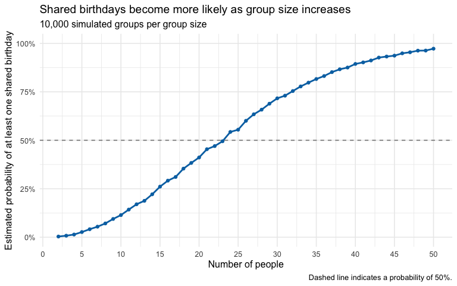
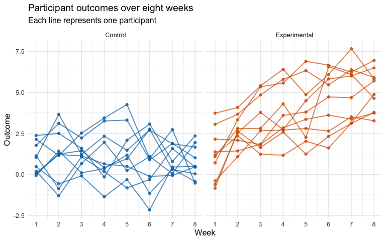

Homework 5
================
Stephanie Chuquipul Calderon

## Problem 1

I use simulation to estimate the probability that at least two people
share a birthday for group sizes from 2 to 50. Birthdays are assumed to
be independent and uniformly distributed across 365 days.

### Birthday simulation function

The function draws one birthday per person with replacement and checks
whether any birthdays repeat.

``` r
shared_birthday = function(group_size) {

  birthdays = sample(
    x = 1:365,
    size = group_size,
    replace = TRUE
  )

  any(duplicated(birthdays))
}
```

### Estimated probabilities

I simulate 10,000 groups for each group size and estimate the
probability of a shared birthday as the proportion of simulations
containing duplicate birthdays.

``` r
set.seed(2153)

birthday_results_df =
  expand_grid(
    group_size = 2:50,
    iteration = 1:10000
  ) |>
  mutate(
    shared = map_lgl(group_size, shared_birthday)
  )

birthday_probability_df =
  birthday_results_df |>
  group_by(group_size) |>
  summarize(
    probability = mean(shared),
    .groups = "drop"
  )
```

### Probability of a shared birthday

``` r
birthday_probability_df |>
  ggplot(aes(x = group_size, y = probability)) +
  geom_line(color = "#0072B2", linewidth = 1) +
  geom_point(color = "#0072B2", size = 1.5) +
  geom_hline(
    yintercept = 0.5,
    linetype = "dashed",
    color = "gray50"
  ) +
  scale_x_continuous(breaks = seq(0, 50, 5)) +
  scale_y_continuous(
    labels = scales::label_percent(),
    limits = c(0, 1)
  ) +
  labs(
    title = "Shared birthdays become more likely as group size increases",
    subtitle = "10,000 simulated groups per group size",
    x = "Number of people",
    y = "Estimated probability of at least one shared birthday",
    caption = "Dashed line indicates a probability of 50%."
  )
```

<!-- -->

The estimated probability of at least one shared birthday increases with
group size. It is approximately 11.4% for 10 people, 49.5% for 23
people, 71.6% for 30 people, and 97.3% for 50 people. Thus, a shared
birthday becomes quite likely even in a group much smaller than 365
people because there are many possible pairs who could share a birthday.
These are simulation estimates, so small fluctuations reflect random
sampling variation.

## Problem 2

### Import participant data

Each CSV file contains one participant’s weekly observations. I first
create a dataframe of file names, then use `map()` to read each file
into a list column.

``` r
participant_files_df =
  tibble(
    file_name = list.files(
      path = "data",
      pattern = "^(con|exp)_[0-9]+\\.csv$"
    )
  ) |>
  mutate(
    path = str_c("data/", file_name),
    observations = map(path, read_csv, show_col_types = FALSE)
  )

participant_files_df
```

    ## # A tibble: 20 × 3
    ##    file_name  path            observations      
    ##    <chr>      <chr>           <list>            
    ##  1 con_01.csv data/con_01.csv <spc_tbl_ [1 × 8]>
    ##  2 con_02.csv data/con_02.csv <spc_tbl_ [1 × 8]>
    ##  3 con_03.csv data/con_03.csv <spc_tbl_ [1 × 8]>
    ##  4 con_04.csv data/con_04.csv <spc_tbl_ [1 × 8]>
    ##  5 con_05.csv data/con_05.csv <spc_tbl_ [1 × 8]>
    ##  6 con_06.csv data/con_06.csv <spc_tbl_ [1 × 8]>
    ##  7 con_07.csv data/con_07.csv <spc_tbl_ [1 × 8]>
    ##  8 con_08.csv data/con_08.csv <spc_tbl_ [1 × 8]>
    ##  9 con_09.csv data/con_09.csv <spc_tbl_ [1 × 8]>
    ## 10 con_10.csv data/con_10.csv <spc_tbl_ [1 × 8]>
    ## 11 exp_01.csv data/exp_01.csv <spc_tbl_ [1 × 8]>
    ## 12 exp_02.csv data/exp_02.csv <spc_tbl_ [1 × 8]>
    ## 13 exp_03.csv data/exp_03.csv <spc_tbl_ [1 × 8]>
    ## 14 exp_04.csv data/exp_04.csv <spc_tbl_ [1 × 8]>
    ## 15 exp_05.csv data/exp_05.csv <spc_tbl_ [1 × 8]>
    ## 16 exp_06.csv data/exp_06.csv <spc_tbl_ [1 × 8]>
    ## 17 exp_07.csv data/exp_07.csv <spc_tbl_ [1 × 8]>
    ## 18 exp_08.csv data/exp_08.csv <spc_tbl_ [1 × 8]>
    ## 19 exp_09.csv data/exp_09.csv <spc_tbl_ [1 × 8]>
    ## 20 exp_10.csv data/exp_10.csv <spc_tbl_ [1 × 8]>

### Tidy weekly observations

I extract study arm and subject ID from the file names and reshape the
weekly measurements into one row per participant per week. Participant
identifiers include the arm because subject numbers repeat across arms.

``` r
longitudinal_df =
  participant_files_df |>
  select(file_name, observations) |>
  mutate(
    participant = str_remove(file_name, "\\.csv$")
  ) |>
  separate(
    participant,
    into = c("arm", "subject_id"),
    sep = "_",
    remove = FALSE
  ) |>
  mutate(
    arm = recode(
      arm,
      con = "Control",
      exp = "Experimental"
    )
  ) |>
  unnest(cols = observations) |>
  pivot_longer(
    cols = starts_with("week_"),
    names_to = "week",
    names_prefix = "week_",
    values_to = "outcome"
  ) |>
  mutate(week = as.integer(week)) |>
  select(participant, subject_id, arm, week, outcome)

longitudinal_df
```

    ## # A tibble: 160 × 5
    ##    participant subject_id arm      week outcome
    ##    <chr>       <chr>      <chr>   <int>   <dbl>
    ##  1 con_01      01         Control     1    0.2 
    ##  2 con_01      01         Control     2   -1.31
    ##  3 con_01      01         Control     3    0.66
    ##  4 con_01      01         Control     4    1.96
    ##  5 con_01      01         Control     5    0.23
    ##  6 con_01      01         Control     6    1.09
    ##  7 con_01      01         Control     7    0.05
    ##  8 con_01      01         Control     8    1.94
    ##  9 con_02      02         Control     1    1.13
    ## 10 con_02      02         Control     2   -0.88
    ## # ℹ 150 more rows

### Individual trajectories over time

``` r
longitudinal_df |>
  ggplot(
    aes(
      x = week,
      y = outcome,
      group = participant,
      color = arm
    )
  ) +
  geom_line(alpha = 0.7, linewidth = 0.7) +
  geom_point(size = 1.5, alpha = 0.8) +
  facet_grid(. ~ arm) +
  scale_x_continuous(breaks = 1:8) +
  scale_color_manual(
    values = c(
      "Control" = "#0072B2",
      "Experimental" = "#D55E00"
    )
  ) +
  labs(
    title = "Participant outcomes over eight weeks",
    subtitle = "Each line represents one participant",
    x = "Week",
    y = "Outcome"
  ) +
  theme(legend.position = "none")
```

<!-- -->

The dataset contains 20 participants, with 10 in each study arm and
eight weekly observations per participant. There are no missing
outcomes. Control participants show week-to-week fluctuations without a
clear overall increase. In contrast, experimental participants generally
show increasing outcomes over time, although individual trajectories
vary. The groups overlap initially but become more separated in later
weeks, with experimental participants generally having higher outcomes.
This plot provides descriptive evidence of different trajectories
between the study arms; it does not establish statistical significance.
